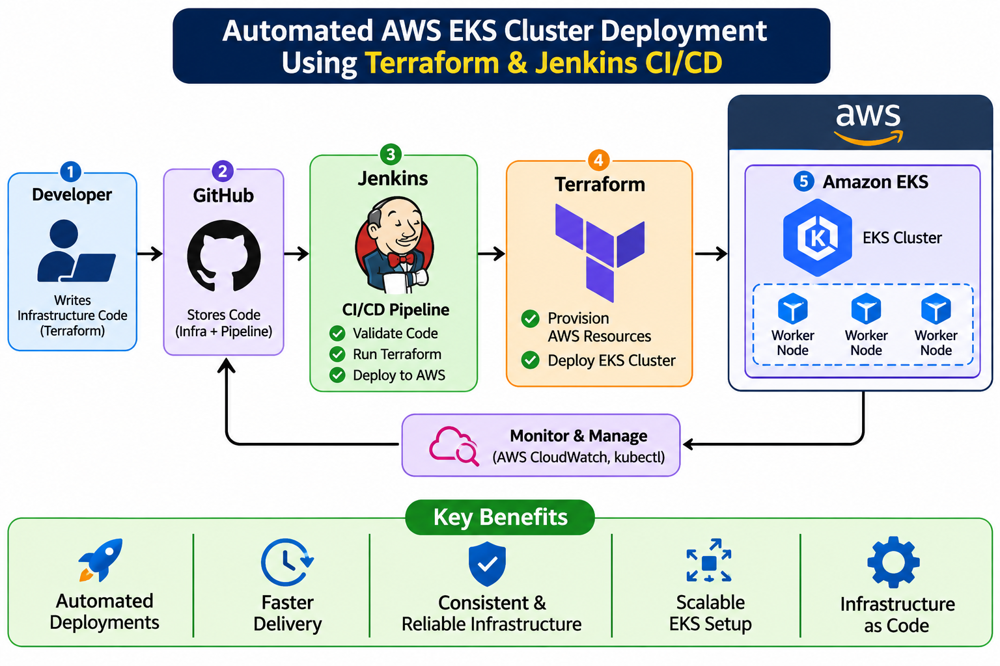

# Automated AWS EKS Cluster Deployment Using Terraform & Jenkins CI/CD

## Project Overview

This project automates the provisioning of AWS infrastructure and deployment of a Kubernetes application using Terraform, Jenkins, and Amazon EKS.

Terraform creates the Jenkins server and EKS infrastructure. Jenkins runs a pipeline to validate and apply Terraform configurations, then deploys an NGINX application to the Kubernetes cluster.

## Architecture

## Technologies Used

- AWS (VPC, EC2, EKS, IAM)
- Terraform
- Jenkins
- Docker / Kubernetes
- NGINX
- AWS CLI
- kubectl
- Git and GitHub

## Project Structure

├── EKS/
│   ├── configuration-files/
│   │   ├── deployment.yml
│   │   └── service.yml
│   ├── backend.tf
│   ├── Jenkinsfile
│   ├── main.tf
│   ├── provider.tf
│   ├── variables.tf
│   └── kubernetes.tf
│
├── jenkins-server/
│   ├── backend.tf
│   ├── jenkins-install.sh
│   ├── main.tf
│   ├── provider.tf
│   └── variables.tf
│
└── README.md

## Workflow

1. Push the project code to GitHub.
2. Jenkins checks out the repository and runs the pipeline.
3. Terraform initializes, formats, validates, and plans the infrastructure.
4. After approval, Terraform provisions the EKS infrastructure.
5. Jenkins configures `kubectl` access to the EKS cluster.
6. Kubernetes manifests deploy NGINX with two replicas and expose it through a LoadBalancer service.

## Result

The project provisions an AWS EKS cluster and deploys an NGINX application using a Jenkins CI/CD pipeline.

